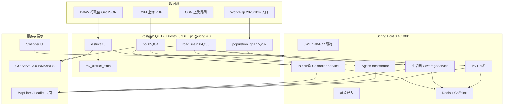
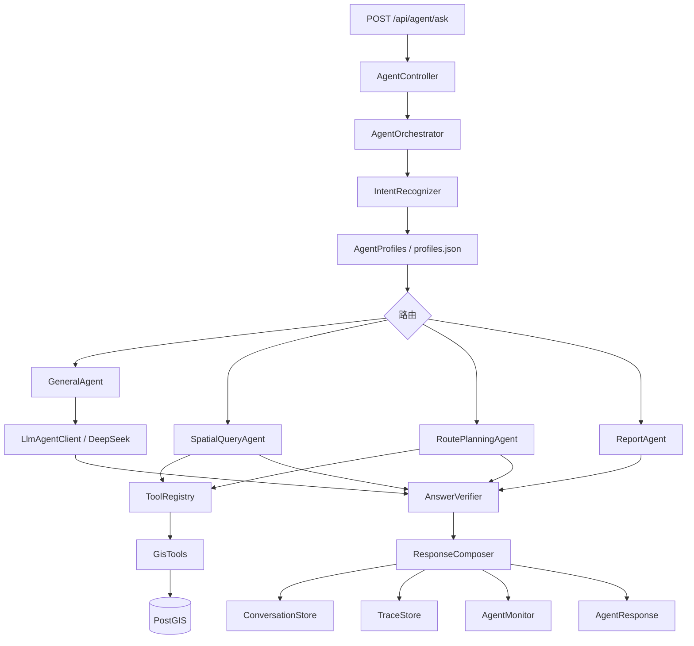
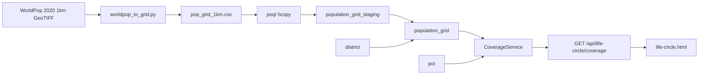
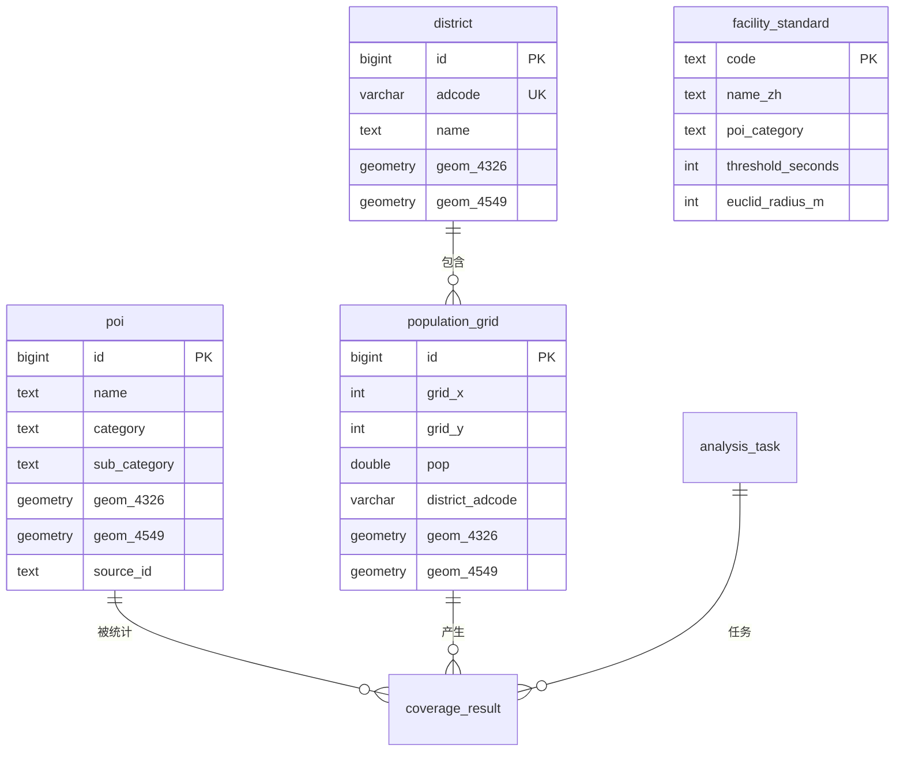

# 架构图

## 1. 总体架构



## 2. Agent 架构（EchoMind 精简版）



### 角色和工具边界

| 角色 | 职责 | 工具范围 |
|---|---|---|
| GENERAL | 问候、能力介绍、兜底 | `search_place`、`list_districts` |
| SPATIAL_QUERY | 周边、最近邻、缓冲区、行政区、排名 | `pois_within`、`nearest_pois`、`buffer_stats`、`district_stats`、`district_ranking`、`district_center`、`default_center` |
| ROUTE_PLANNING | 路线、对比；Valhalla 高精度 + 本地 pgRouting 兜底 | `nearest_pois`、`route_compare` |
| REPORT | 空间诊断报告 | `district_ranking`、`buffer_stats` |

### 调用链

```
POST /api/agent/ask
  → AgentController
  → AgentOrchestrator
  → ConversationStore.rewrite（多轮追问改写）
  → IntentRecognizer（关键词 + 可选 LLM）
  → AgentProfiles 选角色
  → BaseAgent 执行
  → ToolRegistry 调 GisTools（白名单、必填参数、超时）
  → AnswerVerifier（空答案、无工具证据、异常数值）
  → ResponseComposer
  → ConversationStore / TraceStore / AgentMonitor
```

## 3. 生活圈数据流



## 4. 核心数据模型



> 当前 MVP 的覆盖结果按请求实时计算并缓存，`analysis_task/coverage_result` 是后续异步任务化的预留结构；`facility_standard` 已落地。

## 5. 一次请求的完整链路

### 周边查询

```
浏览器 → RateLimitFilter → Security → PoiController
→ PoiService.within
→ PostgreSQL: ST_DWithin(geom_4549, 参数点, 半径)
→ JSON {code,message,data}
```

### MVT 瓦片

```
MapLibre → TileController（Caffeine z/x/y/category）
→ PoiService.tile
→ ST_TileEnvelope → ST_AsMVTGeom → ST_AsMVT
→ Protobuf 瓦片
```

### 生活圈覆盖

```
life-circle.html
→ GET /api/life-circle/coverage?adcode&category&threshold
→ CoverageService
→ population_grid LEFT JOIN covered(poi + ST_DWithin)
→ 汇总人口 + FeatureCollection 网格
→ Redis 缓存 5 分钟
```
